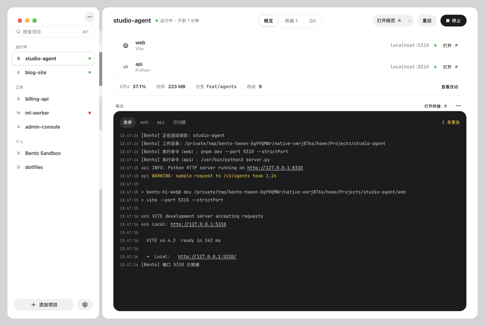
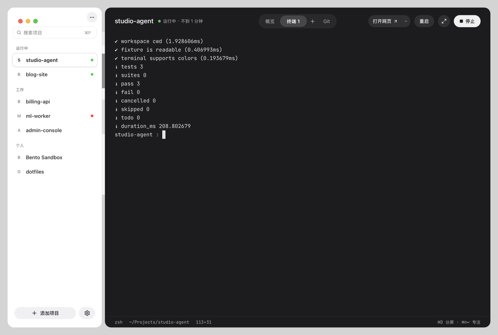
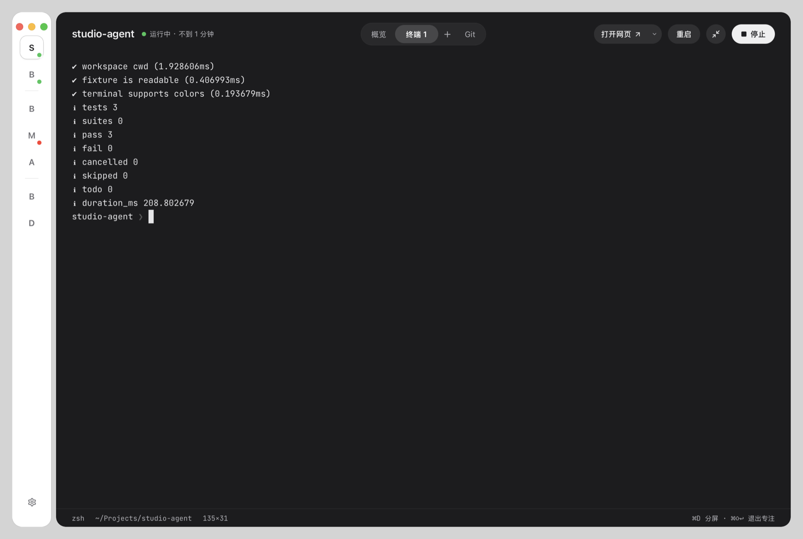
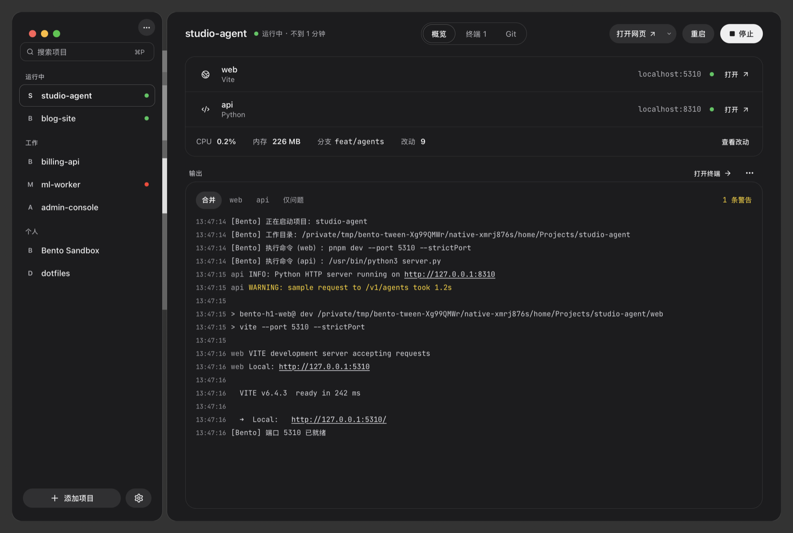

# Bento - 本地项目开发与启动的 macOS 桌面应用

Bento 基于 **Tauri 2 + React + Tailwind CSS**。像便当盒一样，每个项目有自己的一格：一键启停、准确的运行状态、启动日志，以及常驻的交互终端，可以直接在里面用 Claude Code、Codex 等 AI CLI 开发。不用再为每个项目分别开开发终端和运行终端，项目再多也不会乱。

## 界面预览



概览汇集服务状态、CPU 与内存、Git 改动和启动输出。

| 交互终端 | 专注模式 | 深色外观 |
| --- | --- | --- |
|  |  |  |
| 深色终端铺满主面板，可从顶栏切换会话。 | 专注模式将侧栏收成图标栏，为终端腾出空间。 | 深色概览保留双面板布局，缝隙仍透出桌面。 |

---

## 项目管理

- 要**新建项目**，可点击侧边栏底部的「添加项目」、侧栏空状态的「添加第一个项目」，或按 Cmd+N。也可在 Cmd+P 面板输入「添加 / 新建 / add / new」，选择「添加项目…」或「添加分组」。目录可以用系统文件夹选择器选择，也可以手动输入（支持 `~`）。选定后会自动识别名称、类型（有 `src-tauri` 即为桌面应用）、启动命令（根据 lock 文件判断 pnpm / yarn / bun / npm，以及 `dev`、`start`、`tauri` 脚本）和端口。端口扫描覆盖 Tauri、Vite / Next / Nuxt / Astro 配置、`angular.json` 的 serve 配置、`.env` / `.env.local` / `.env.development` 中的 `PORT` / `VITE_PORT`、`package.json` 各脚本和 `start.sh` 中的 `--port` / `-p` / `PORT=`、Compose 的宿主端口以及框架默认值。候选端口合并来源、按置信度排列，可点击填入。没有候选时推荐空闲端口。端口用于监测监听、打开网页和启动时的端口适配，可留空以使用项目默认值。
- **从 Finder 拖入文件夹**时，侧栏的虚线提示区会显示文件夹名。松开后预填目录、启动命令与候选端口，确认表单后才保存。非文件夹、不存在的路径或已经添加的目录（含同一目录的符号链接）会提示原因，表单不会打开。一次拖入多项只处理首项并显示提示。
- **端口检查**会阻止保存与其他 Bento 项目重复的端口。其他进程占用（含 PID / 命令）、macOS AirPlay 常用的 5000 / 7000、1024 以下端口则会显示提醒，仍可保存。编辑时会排除项目自身的配置和运行实例。有冲突或提醒时可点击「改用」填入下一个未被项目配置或进程监听的端口。启动时会按下节的规则适配所选端口。
- 概览的**快捷操作**可以在编辑器打开项目、新建终端、查看改动、在 Finder 中显示或编辑配置。概览输出区和侧栏项目的「···」菜单提供复制路径、查看已有启动日志和删除项目。删除需先确认，会停止由 Bento 启动的进程并关闭该项目的终端，保留项目目录中的文件。
- **高级设置**位于编辑项目窗口。
  - **环境变量**在启动命令执行前导出，因此不会被 `.zprofile` 覆盖。项目终端重启后也会带上这些变量。支持直接粘贴 `.env` 内容。变量以明文保存在本地数据库中，请勿填写敏感凭据。
  - **其他命令**可添加 build、test 等命令，最多 10 个。在 Cmd+P 面板选择目标项目后，可从操作区执行「运行 build」等操作。优先使用当前空闲终端，其次使用另一个空闲终端。没有空闲终端时，先重启已退出的终端（优先当前终端），再尝试新建。所有终端都忙且已达上限时会提示。执行后自动切换到使用的终端。
  - **启动就绪后自动打开网页**适用于已配置网页端口的 Web 项目。由 Bento 启动、且端口就绪后打开一次浏览器。
- **Git 信息**会出现在 Git 项目的概览和「Git」标签。概览显示分支和项目目录内的改动数，「Git」标签可查看与上游分支相差的提交数、最近一次提交和改动文件。读取时使用 `GIT_OPTIONAL_LOCKS=0`。

## Bento 启动标准

在编辑项目中填写端口并开启「端口注入」，Bento 会根据启动命令传递对应参数和环境变量。编辑页的「启动时将执行」显示实际命令和端口变量。这些参数和变量只作用于 Bento 启动的进程。项目配置文件保持原样，从其他终端直接启动时仍使用项目默认端口。端口留空或关闭端口注入时，保留原命令和手动填写的环境变量。

- Vite 和基于 Vite 的 SvelteKit 使用 `--port N --strictPort`，Next.js 使用 `-p N`。Nuxt、Astro、Angular（`ng serve`）、Remix 的 Vite 模式和 Uvicorn 使用 `--port N`。
- Flask 使用 `--port N` 和 `FLASK_RUN_PORT`，Django 的 `manage.py runserver` 使用 `127.0.0.1:N`。Spring Boot（Maven 或 Gradle）使用 `SERVER_PORT`。
- `tauri dev` 会通过 `--config` 临时覆盖开发地址的端口，并适配 `beforeDevCommand`。支持 `src-tauri` 下的 JSON、JSON5、TOML 配置以及 Tauri v1 的 `devPath`。
- CRA、Express、Nest、Rails、Puma、Node、Go、Rust 等会收到 `PORT`。框架或项目程序可读取该变量。经典 `remix dev` 通过 `PORT` 设置应用端口，保留其热更新端口。
- Bento 会读取 npm、pnpm、Yarn、Bun 对应的 `package.json` 脚本。已有端口参数会替换。如果参数写在包脚本里，Bento 会在包目录中执行调整后的命令，预览会显示这一形式。
- 对自行封装的启动命令，可在参数位置写 `{port}`，例如 `./dev.sh --listen {port}`。多服务也可写 `{port:WEB}`、`{port:API}`。使用占位符时只替换占位符，并保留环境变量注入。
- 当已配置端口未监听、Bento 启动的进程树监听了其他端口时，概览会显示实际端口和占位符用法。

### 多服务项目

- 每个服务都填写独立启动命令时，Bento 在各服务目录执行适配后的命令，并给该服务提供自己的 `PORT`。全部留空时，继续用项目根目录的总启动命令统一启停。总命令收到「打开网页」所选端口作为 `PORT`。
- 多服务变量仍包括 `BENTO_PORT_<KEY>`（例如 `BENTO_PORT_WEB=3100`、`BENTO_PORT_API=8100`）和 `BENTO_PORTS=WEB:3100,API:8100`。角色 key 在同一项目内唯一，由大写字母、数字和下划线组成。Web 与 API 默认使用 `WEB`、`API`，其余按目录名生成。「高级设置」中的同名环境变量优先。

脚本可以这样读取标准变量，并为脱离 Bento 直接运行保留默认值。

```bash
#!/usr/bin/env bash
set -euo pipefail
WEB_PORT="${BENTO_PORT_WEB:-${PORT:-3100}}"
API_PORT="${BENTO_PORT_API:-8100}"
export API_PORT
```

启动 Vite 时传入 `--port "$WEB_PORT" --strictPort`，Next.js 使用 `-p "$WEB_PORT"`。Uvicorn 或 Flask 使用 `--port "$API_PORT"`。前端开发服务器可从 `process.env.API_PORT` 生成代理地址。

```ts
const apiPort = process.env.API_PORT || '8100'
const proxy = {
  '/api': { target: `http://127.0.0.1:${apiPort}`, changeOrigin: true },
}
```

使用总启动命令的多服务项目可在编辑窗口重新扫描时查看脚本合规检查。缺少标准端口变量引用时，概览的快捷操作卡显示「未配置启动」，点击可打开编辑配置。也可以在编辑窗口预览并生成 `scripts/bento-dev.sh`，确认后写入新文件。保存项目后才应用填入的启动命令。

## 运行与状态

- **启动环境**：每次启动都会读取登录 shell，使用与项目终端相同的环境；`.zshrc` 中定义的别名和函数不可用。读取失败时会在日志中提示，并改用登录 shell 启动，此时 `.zshrc` 中的设置可能不会生效。
- 仅使用项目级端口时，Bento 会等端口开始监听，再从**启动中切换到运行中**。使用服务列表时，Bento 按启动进程及所属监听进程判断运行状态，概览逐项显示各端口是否就绪。配置的主端口超过 60 秒仍未监听时，日志会提示核对端口配置。
- 端口开始监听后，可从顶栏**打开网页**或点击概览中的服务条目，用系统默认浏览器打开。多服务可在下拉菜单中选择服务或更改默认打开的服务。HTTP 健康状态单独显示。
- 进程异常退出时，概览显示**运行异常**，并在上次运行中显示退出码或信号。可从输出区打开启动日志，重新启动会清除异常状态。
- **停止**：由 Bento 启动的项目会连同整个进程树一起停止，包括已经脱离进程组的子进程。
- 如果监听端口的服务由**外部进程**启动，点击停止或重启会先列出 PID、命令和工作目录供确认。端口冲突也可在概览处理，可改用另一个端口或确认结束占用进程。
- **全部停止**位于侧栏顶部「项目筛选与操作」菜单，有 Bento 管理的运行中或启动中项目时可用。确认后统一停止这些项目，外部进程不受影响。
- **菜单栏图标**：图标旁显示运行中项目的数量。菜单中列出这些项目（点击即可打开），并提供「全部停止…」「显示 Bento」和「退出 Bento」。
- 概览的服务和快捷操作并排显示，输出填满下方空间。服务较多时滚动服务列表，日志在输出区内滚动。服务卡底部显示 CPU、内存和运行时长，点击可看历史曲线。停止后可查看上次运行时长、退出结果、峰值内存和错误数。
- **启动日志**按项目保留最近 500 行，合批推送和刷新。多服务项目可按服务筛选，「仅问题」汇总警告和错误，也能跳到最近的错误。「查看启动日志」可打开日志弹窗。

## 侧边栏

- 展开的侧栏宽 264px，项目行至少 40px 高，显示首字母头像、名称和状态点（有状态或提醒时显示）。端口可在概览查看，「概览 / 终端 N / Git」统一在主面板顶栏切换。
- **分组**可通过分组标题旁的按钮新建，也可在新建 / 编辑项目的「分组」下拉中管理归属。点击自建分组标题展开或折叠，折叠状态保存在数据库。标题右键或更多菜单可重命名、删除，删除后项目移回未分组。未分组排在自建分组之后。没有自建分组时，未分组列表显示为「项目」。
- **置顶 / 归档**：通过项目行右键菜单切换。置顶项目排在最上方，保留原分组归属。已归档项目进入底部默认折叠的「已归档」区，仍可搜索、启动和打开终端；归档不会停止正在运行的服务。
- **运行中**摘要在置顶区之后，显示运行中和启动中的项目，可以收起或单独滚动。展开时，未分组的运行项目移到摘要中，已分组或置顶的项目仍保留原来的入口。搜索或状态筛选时暂时隐藏摘要。
- 侧栏支持按名称、路径或端口**搜索与筛选**。概览中按 Cmd+F 聚焦搜索框。用 ↑ / ↓ 选择，Enter 打开，Esc 清空。顶部「项目筛选与操作」菜单可叠加「全部项目 / 运行中 / 终端提醒 / 有改动」筛选。有改动以项目的 Git 状态判断，可见窗口每 15 秒刷新。搜索和筛选会临时展开匹配的分组，归档项目也参与搜索。
- **排序**：拖动项目行调整组内顺序或移入其他分组，拖动分组标题旁的把手调整分组顺序。项目行上按 Option+↑ / Option+↓ 调整组内顺序，分组把手也支持同样的快捷键。顺序会保存，新建项目排在最后；搜索或状态筛选期间不能排序。
- **快速切换面板**：概览与终端中均可按 Cmd+P，搜索名称、路径或端口（含已归档项目）。名称及显示别名按「前缀 → 连续子串 → 子序列」优先匹配；路径只匹配连续子串，优先最后一段，排在名称匹配之后；端口连续匹配保留在名称与路径之间。匹配不区分大小写，归档结果统一放在未归档项目之后。↑ / ↓ 选择项目或操作，Enter 打开，Cmd+Enter 启动 / 停止，Cmd+T 为选中的项目新建终端，Cmd+N 添加项目，Esc 关闭。操作区在无输入时提供「添加项目… / 添加分组」，也支持输入「添加 / 新建 / add / new」查找；匹配添加操作时优先显示操作，项目结果随后列出。中文输入法选词期间不触发快捷键。Cmd+K 继续用于清空终端画面。
- **数字切换**：Cmd+1 到 Cmd+9 按当前项目列表顺序（置顶 → 自建分组 → 未分组）切换，跳过归档项目。运行摘要不重复占用编号。

## 交互终端

每个项目支持多个独立终端，在项目目录中启动当前用户的交互式登录 shell，并带上项目环境变量，可运行任意命令。输入 `claude` 可启动已安装的 Claude Code。顶栏按顺序显示「终端 1」「终端 2」等标签，首次打开时创建「终端 1」。可用终端标签旁的「+」、侧边栏项目行上的「+」（悬停或聚焦时显示）或 Cmd+T 新建终端。按 Cmd+Shift+[ / ] 可在终端视图中循环切换前后会话。设置中的「每个项目最多终端数」默认为 2 个，可选 1–6 个。调低上限只限制继续新建，已打开的终端会保留。

切换项目时会打开标签顺序中的第一个终端，已退出但仍保留的会话也会被选中。没有会话时进入概览。

切换终端、切换项目、返回概览或重载 WebView 时，已打开的终端会继续运行并恢复各自的输出。右键点击终端标签可选择「重启」或「关闭」，悬停时也可点标签上的「×」关闭。活跃会话会弹窗确认，已退出的会话可直接操作。关闭后新建会复用空出的编号。会话和输出只保留在内存中，完全退出 Bento 后重新打开时会创建新的 shell。

- **沉浸终端**铺满主面板，顶栏同步切换为深色。底部显示 shell、当前目录、列数和行数。
- 在终端中按 ⌘⇧↩ 或点击顶栏的「专注」按钮进入**专注模式**，侧栏从 264px 收为 64px 图标栏。再次按 ⌘⇧↩ 或点击「退出专注」恢复。Esc 保留给终端内的程序。
- 在终端中按 ⌘D 切换**左右分屏**。左侧保留当前终端，右侧可从下拉菜单选择另一终端、合并日志或单个服务的日志。拖动中间的分隔线可调整两栏宽度。专注与分屏操作也可以在终端视图的 Cmd+P 面板找到。
- **多行输入**：Shift+Enter 插入换行，适用于 Claude Code 和 zsh 的 emacs 键位，不会提交当前输入；中文输入法正在选词时保留原生的确认行为。
- **查找**：终端视图中按 Cmd+F 打开查找栏，输入即高亮匹配，不区分大小写。Enter / Shift+Enter 或 Cmd+G / Cmd+Shift+G 查看下一个 / 上一个匹配；Esc 关闭并回到终端。切换终端或返回概览会关闭查找，再打开时保留本次使用的查询。搜索项目请使用侧栏搜索框。
- **字号**：终端视图中按 Cmd+= / Cmd+- 放大 / 缩小，Cmd+0 恢复默认 14 px，范围为 12–20 px；与设置中的字号同步，适用于所有终端并会保存。
- 悬停「终端 N」标签可查看程序设置的**终端标题**，shell 的纯路径标题会被省略。
- **终端提醒**在标签上显示为灰点，侧栏则在项目状态点外加细环。未在前台查看的终端，持续输出至少 2 秒后安静 3 秒，或收到 BEL、OSC 9 / OSC 777 通知时，会触发提醒。Dock 角标按终端计数，Bento 不在前台时会请求一次弹跳。Cmd+Shift+U 跳到最新的提醒，查看会话后清除该终端的提醒。
- **自然编辑**：Option+← / → 按单词移动，Cmd+← / → 跳到行首 / 行尾；Option+Backspace 删除前一个词，Cmd+Backspace 删除到行首；Cmd+K 清空终端画面，Cmd+C 复制选区（没有选区时不做任何事），Ctrl+C 中断命令；Cmd+V 通过 macOS 编辑菜单粘贴。
- **智能句号**：用键盘或输入法输入 `1。` 会变成 `1.`，中文后面的 `。` 保持不变；粘贴和拖入的内容不做转换。
- **图片与文件**：从 Finder 拖文件到终端，会插入带 shell 转义的绝对路径，支持空格、中文和特殊字符；在 Claude Code 中，图片路径会作为图片附件。复制图片后在 Claude Code 中按 Cmd+V，Bento 会交给 Claude Code 去读取系统剪贴板。

## 窗口与退出

- **磁吸双面板**由侧栏和主区组成，两块面板各有 16px 圆角和发丝边。中间留有 8px 透明缝，可以看到桌面。两块面板的顶部空白区域都可以拖动窗口。
- 在设置的**外观**中选择「跟随系统」「浅色」或「深色」，窗口与界面会立即切换并记住选择。界面以黑白灰为主，运行状态用绿点，运行异常和端口冲突用红点，终端日志的警告用黄色。终端主面板在两种外观下均保持深色。
- **GSAP 动效**用于窗口入场、专注模式收展、标签和项目高亮切换、弹窗开合等场景。切换标签时，等目标就绪后交叉淡入，背景与顶栏配色同步变化。启用系统的「减弱动态效果」后，目标就绪即直接切换。
- 可在设置中启用**登录时启动 Bento**，登录 macOS 后会在菜单栏中静默运行。

窗口首次打开时约占当前屏幕可用区域的 75% 宽、80% 高。关闭主窗口（红色按钮或 Cmd+W）只是隐藏窗口，点击 Dock 图标或菜单栏图标菜单中的「显示 Bento」可以恢复；窗口隐藏期间暂停状态轮询。

按 Cmd+Q 或选择「退出 Bento」时，如果还有 Bento 管理的项目进程或活跃终端，会列出它们，确认「停止并退出」后才退出。取消则保留窗口和任务。没有运行中的任务时直接退出。从 Dock 选择「退出」或关机时会直接停止 Bento 启动的项目进程树并清理终端，外部启动的服务仍继续运行。

## 快捷键

| 快捷键 | 作用 |
| --- | --- |
| Cmd+N | 全局添加项目，概览、终端聚焦与快速切换面板中均可用 |
| Cmd+P | 在概览或终端中打开快速切换面板（含已归档项目） |
| ↑ / ↓、Enter、Esc | 快速切换面板中选择、打开、关闭 |
| Cmd+Enter、Cmd+T | 快速切换面板中启动 / 停止所选项目、新建终端 |
| Cmd+F | 终端视图中查找终端内容；概览中搜索项目 |
| Enter / Shift+Enter、Cmd+G / Cmd+Shift+G | 查找栏打开时下一个 / 上一个匹配 |
| Esc | 关闭终端查找并回到终端 |
| Cmd+= / Cmd+-、Cmd+0 | 终端视图中放大 / 缩小字号、恢复默认 |
| Cmd+Shift+U | 跳到最近需要处理的终端 |
| Cmd+T | 为当前项目新建终端并切换到终端视图 |
| Cmd+Shift+[ / ] | 在终端视图中循环切换前后终端 |
| ⌘⇧↩ | 在终端视图中进入或退出专注模式 |
| ⌘D | 在终端视图中切换左右分屏 |
| Cmd+1 … Cmd+9 | 切换到项目列表中的第 N 个未归档项目 |
| Option+↑ / Option+↓ | 调整组内项目顺序；聚焦分组把手时调整分组顺序 |
| Cmd+K | 清空终端画面 |
| Cmd+O | 在编辑器中打开当前项目 |
| Option+Cmd+R | 在 Finder 中显示当前项目 |
| Cmd+, | 在概览编辑项目配置，其他位置打开 Bento 设置 |
| Cmd+W | 隐藏窗口 |
| Cmd+Q | 退出（有运行中的任务时先确认） |

## 数据与命令行

项目配置保存在本地 SQLite 数据库 `~/.apphub/apphub.db` 中（Bento 原名 AppHub，数据目录沿用了原来的名字）。新版本 Bento 首次打开时会自动迁移表结构，并保持原有的项目顺序。除了在界面中管理，也可以使用命令行脚本：

```bash
python3 scripts/manage_project.py list
python3 scripts/manage_project.py check-port 5173
python3 scripts/manage_project.py add --name my-app --path ~/Projects/my-app --command "pnpm dev" --port 3000 --type web
python3 scripts/manage_project.py update --id my-app --port 3001
python3 scripts/manage_project.py update --id my-app --group "工作"
python3 scripts/manage_project.py list --group "工作"
python3 scripts/manage_project.py update --id my-app --group "" # 移回未分组
python3 scripts/manage_project.py delete my-app
```

各项目的端口必须唯一。通过脚本修改后，从侧边栏顶部「项目筛选与操作」菜单选择「刷新项目状态」，即可重新加载项目列表。`.agents/skills/bento/SKILL.md` 是供 AI 助手使用的项目管理技能说明。

`add / update --group "名称"` 会复用同名分组，名称不存在时新建；省略 `--group` 保持原有行为，`update` 保留当前分组。`list` 显示分组与置顶 / 归档标记，可用 `--group ""` 仅查看未分组项目。数据库新增 `groups(id, name, sort_order, collapsed)`，项目新增 `group_id / pinned / archived`；老项目默认未分组、未置顶、未归档。

## 升级

请先把 Bento 拖到「应用程序」文件夹再使用更新。应用启动后会自动检查新版本，之后每 6 小时检查一次。有更新时，侧边栏顶部的「项目筛选与操作」菜单会显示「更新到 v<版本>」，更新提示中的「查看」也能打开更新说明。可以在设置的「关于」或 Bento 菜单中手动检查更新。

确认「更新并重启」后，Bento 会先下载、验证签名并安装。成功后重启会停止由 Bento 启动的项目，以及打开的终端中运行的命令；下载或安装失败时，这些任务继续运行。

## 开发与构建

正式版本由 GitHub 从 `release` 分支构建并发布到 [GitHub Releases](https://github.com/kohlarnhin/Bento/releases)。下载适合自己 Mac 的 DMG：`Bento_<版本>_arm64.dmg` 用于 **Apple 芯片**，`Bento_<版本>_x64.dmg` 用于 **Intel**。打开 DMG，把 `Bento.app` 拖到「Applications」即可安装。

应用使用 ad-hoc 签名，尚未经过 Apple 公证。macOS 15 首次打开被拦截时，先尝试打开一次，再到「系统设置 → 隐私与安全性」点击「仍要打开」并确认；也可以在终端执行后重新打开：

```bash
xattr -dr com.apple.quarantine /Applications/Bento.app
```

开发在 `dev` 分支进行，发版前在 `dev` 运行 `node scripts/bump-version.mjs`，同步更新四处版本号，再合并到 `release`。版本从 `0.1.0` 开始逐次加一，满十进位，例如 `0.1.9 → 0.2.0`、`0.9.9 → 1.0.0`。首个版本直接发布 `0.1.0`，无需先递增。`--print` 只预览，`--check` 检查版本是否一致。更新说明写在 `release-notes/v<版本>.md`，会显示在应用的更新弹窗和 GitHub Release 里；没有这个文件时，自动列出上个版本以来的 feat / fix / perf / style 提交。

```bash
./start.sh          # 检查环境、安装依赖并启动桌面应用开发模式（pnpm tauri dev）
./start.sh web      # 只启动前端界面 http://localhost:1420
./start.sh build    # 构建本地测试应用，不用于分发，无需发布签名密钥
```

也可以直接使用 `pnpm tauri dev` 和 `pnpm dev`。本地测试构建产物位于 `src-tauri/target/release/bundle/macos/Bento.app`。运行 `npm test` 执行 Node 测试，`npm run build` 检查 TypeScript 并构建前端，`cd src-tauri && cargo test` 执行后端测试。
